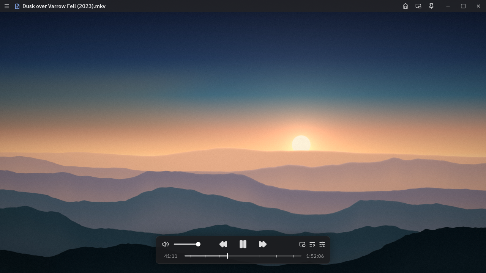
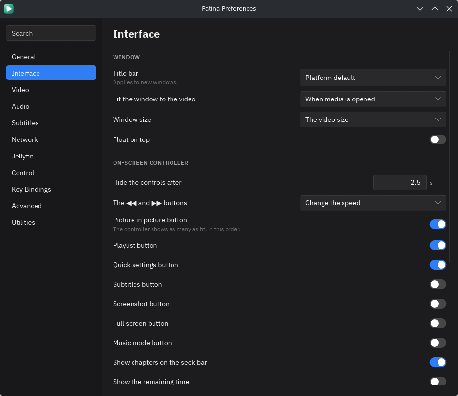

# Patina

[Patina](https://patina.video/) is a media player for Linux, macOS and Windows, written in Rust with a
[Slint](https://slint.dev) interface on top of [mpv](https://mpv.io). It
follows [IINA](https://iina.io)'s design and behaviour, and its goal is
feature parity with IINA on all three platforms.





Patina is at an early stage. Playback, the IINA-style window and controls,
the sidebars, menus, key bindings and history work today; much of IINA is
still to come. [docs/parity.md](docs/parity.md) tracks every IINA feature
and its state in Patina.

## What works

- Video through mpv's OpenGL render API, with hardware decoding
  (VA-API tested; mpv picks the decoder)
- IINA's window: video edge to edge, a title bar and floating controller
  that fade out together, a draggable controller, and a welcome view with
  resume, open and recent files
- The controller: volume, play/pause, IINA's speed-ladder arrow buttons,
  toolbar buttons, a seek bar with buffered range, chapter ticks and A-B
  loop range, and a hover preview with a thumbnail, the time and the chapter
  (thumbnails are made in the background and cached)
- On-screen messages for volume, seeking, speed, delays, tracks, loops,
  chapters and video adjustments
- The playlist and chapters sidebar, with other files from the same folder
  added automatically, each file's length and how much of it you watched,
  title and artist for tagged music, multi-select, drag-and-drop
  reordering, copy and paste, and IINA's row menu (play next, subtitles for
  one file, move to trash, ...)
- Quick settings for video (tracks, aspect ratio, crop, rotation, flip,
  mirror, speed, deinterlacing, hardware decoding, colour), audio (tracks,
  external audio, delay, 10-band equalizer, output device) and subtitles
  (primary and secondary tracks, external files, delay, scale, position)
- Subtitle files found for you as IINA does: by name, by episode number
  across a season folder, in subfolders such as `Subs/`, preferred
  languages first
- An application menu (right click, or the title bar's menu button) with
  IINA's File, Playback, Video, Audio, Subtitles, Window and Help menus
- A preferences window with IINA's pages and a search field; changes
  apply to running players immediately
- Key bindings in mpv's `input.conf` format with IINA's defaults, edited in
  the preferences with a key recorder; IINA's `#@iina` lines work as-is
- Media keys and the desktop's player controls: MPRIS on Linux, the
  media panel on Windows, Now Playing on macOS (not yet tried there)
- Mouse actions: click, double click, right and middle click, and the
  scroll wheel for volume, seeking or speed, as in IINA's control
  preferences
- Several windows at once, each with its own player, and one Patina at a
  time: files opened from a terminal, a file manager or a `patina://` link
  go to the running Patina, which comes to the front
- File associations: Preferences › Utilities makes Patina the default for
  videos, music or playlists (on Windows it adds Patina to Open With and
  Default apps, and uninstalling takes that out again); the macOS bundle
  declares its file types, and `packaging/linux` has the desktop entry,
  which the Flatpak installs for the system's own default-app settings
- `patina://open?url=…` links for browser extensions and web pages, as
  IINA's `iina://` scheme, limited to streams and to mpv options that are
  safe for a web page to set
- Keeping the screen awake during playback (or for music only the
  computer)
- A playback history window, grouped by day or folder and searchable, and
  an inspector with the file, its tracks, live playback statistics and any
  mpv property you choose to watch
- A Media Info window (Window › Media Info, Ctrl+Shift+I) with what is
  playing: its tags, cover art and location, and each stream's codec,
  language and format (a video's resolution, pixel format and colors, an
  audio track's sample rate, channels and sample format), following the
  file and its tracks as they change
- Music mode, IINA's mini player: the cover with the title and artist (an
  album in one file by its chapters), compact controls and the playlist as
  a drawer below; it comes on for audio files and goes for video, and
  audio played out of it has a button back in the controller
- Resuming where you left off, screenshots, URLs and network streams, A-B
  loops, and a compact always-on-top picture-in-picture window
- Online video through yt-dlp, with what IINA's Online Media plugin adds:
  a quality preference, Video Quality and Audio Quality menus for each
  video that switch where it is playing, and downloads, with a Downloads
  window that shows their progress
- Subtitles from OpenSubtitles.com, found by the file's hash and name in
  your languages, with your own API key and, if you like, your account,
  whose password stays in the system's password store
- Your Jellyfin server's library in the player window, which IINA leaves
  to a plugin: films, shows and music to browse and play, played straight
  from the server or converted by it when you ask for a lower quality,
  with your place and what you've watched kept on the server, the next
  episode lined up, intros and credits skipped where the server marks
  them, its previews in the seek bar, and its files to download
  ([docs/jellyfin.md](docs/jellyfin.md))
- A YouTube section, with no account and no sign-in: a feed of the channels
  you follow, search, a Watch Later list, the videos played and downloads.
  The lists are Patina's own and don't appear on YouTube; they import from
  and export to the files of Google's data export, and the channels to
  NewPipe's subscriptions file too
  ([docs/youtube.md](docs/youtube.md))

Written but not yet tested: drag and drop, playing from standard input,
saving playlists, and pausing when minimized.

### The YouTube section and your privacy

Having no account doesn't make the section invisible to Google. Nothing goes
until you open it, but opening it asks YouTube about each channel you follow
(if the last check is over 30 minutes old) and fetches thumbnails, so Google
can see your network address and which channels you follow, along with what
you search for and play. The HTTP proxy preference covers all of it, and
nothing goes direct if a proxy can't be used. Nothing goes to the developer,
and watched marks stay on your computer.

YouTube's terms bar downloading and automated access, which this section does
through yt-dlp. That's stated here as a fact and not as legal advice: using
it is your choice. [docs/youtube.md](docs/youtube.md) says what each request
carries.

## Installing

There is no release yet. From the first one on, each release on GitHub
carries:

- `patina-vX.Y.Z-x86_64.flatpak` and `patina-vX.Y.Z-aarch64.flatpak`:
  Flatpak bundles with libmpv, yt-dlp and Deno inside, installed with
  `flatpak install --user patina-vX.Y.Z-x86_64.flatpak` (the runtime comes
  from Flathub; Patina itself is not on Flathub). In the sandbox Patina reads
  any file, but on its own writes only to Downloads and Pictures/Patina (and
  to whatever file is chosen in a Save dialog), so it can move to the trash
  only what is there.
- `patina-vX.Y.Z-macos-universal.zip`: Patina.app for macOS 11 and later,
  signed and notarised, with libmpv, yt-dlp and ffmpeg inside. With
  Homebrew, `brew install --cask jzbz/tap/patina` installs it and a `patina`
  command.
- `patina-vX.Y.Z-x86_64-setup.exe`: an installer for Windows 10 and 11 that
  installs for the current user, without administrator rights; and
  `patina-vX.Y.Z-windows-x86_64.zip`, the same files to run from any folder.
  Both carry libmpv, yt-dlp and an LGPL ffmpeg.
  `winget install Patina.Patina` will install it once winget has the package.

Nothing else needs installing for online video or downloads. Each release
carries the newest yt-dlp there was when its commit was made (the release
workflow refuses a tag whose pin was older), and Patina doesn't update it
by itself; the YouTube section says when it is more than 90 days old. A
yt-dlp you installed yourself (with Homebrew, winget or pip) is used
instead when it is the newer of the two, which Patina asks each once, so
keeping your own up to date is enough; the Downloads window says which
one is in use. To use a particular one whatever its age, set where it is
in Preferences › Network, or put it in mpv's configuration folder. The bundled
ffmpeg, a few MB built from FFmpeg's source for this alone, joins video
and audio and makes yt-dlp's usual fixes, and converts nothing: yt-dlp
options of your own such as `--extract-audio` or `--embed-subs` fail with
ffmpeg's own error and need a full ffmpeg. It wins over one named in your
own yt-dlp configuration file; to use another, name it with
`ffmpeg-location=` in Patina's yt-dlp options (Preferences › Network), as
Patina opened from the Finder doesn't see Homebrew's. Downloading a live
stream as it plays needs one too (with the bundled one, Patina says it can
be downloaded once it has ended), and so does joining a video that a site
other than YouTube serves in several parts, which takes its ffprobe as
well. Neither the
macOS nor the Windows package bundles a JavaScript runtime such as Deno;
yt-dlp then asks YouTube only for what plays without one. The bundled
yt-dlp is yt-dlp's own folder build, which loads Python from beside itself
rather than unpacking it on every start, and starts in about a third of a
second; a first start has taken a few seconds, for a reason not yet found.
It is GPL-3.0-or-later as a
whole, for the libraries its build carries,
though yt-dlp's own code is Unlicense, and the bundled ffmpeg is
LGPL-2.1-or-later; `THIRD-PARTY.md` in each package lists what it carries
and where its source is.
- `SHA256SUMS` and `SHA256SUMS.asc`: the checksums of all of these, signed
  with the PGP key `252B 901C 8885 3CF9 F939  2559 2497 38C8 641C 3359`.
  Get the key with `gpg --locate-keys jz@jz.bz` (or
  `curl -sL https://github.com/jzbz.gpg | gpg --import`) and compare
  `gpg --fingerprint jz@jz.bz` with the fingerprint above; then
  `gpg --verify SHA256SUMS.asc SHA256SUMS` and
  `sha256sum --check --ignore-missing SHA256SUMS` check a download.

## Requirements

- Rust 1.99.1, which `rust-toolchain.toml` selects automatically
- libmpv from mpv 0.39 or newer, built with Lua (developed against 0.41 and 0.42).
  Ubuntu 26.04 and Debian 13 ship a recent enough one; Ubuntu 24.04 (0.37)
  and Debian 12 (0.35) are too old
- OpenGL 3 or OpenGL ES 3 (mpv's minimum is OpenGL 2.1 or ES 2.0). Without
  it Patina falls back on software rendering, which works anywhere but
  costs CPU; `PATINA_RENDERER=software` asks for it
- For online video, yt-dlp (and for YouTube, a JavaScript runtime such as
  Deno, which yt-dlp finds by itself); downloads that join separate video
  and audio need ffmpeg. The YouTube section needs yt-dlp too, to search,
  play and download. Every package carries yt-dlp and ffmpeg (the Flatpak
  Deno as well), so only a build of your own needs them installed

Patina loads libmpv when it starts rather than linking to it, so building
needs no mpv development files. It looks for the library beside the
executable first (in `lib/` on Linux, `../Frameworks` on macOS), then on the
system search path, and on macOS in Homebrew's and MacPorts' prefixes.
`PATINA_LIBMPV` can point to a specific file.

### Linux

Install mpv from your distribution (Arch: `mpv`; Debian and Ubuntu:
`libmpv2`). Building the interface also needs `pkg-config` and the
fontconfig development files (Debian and Ubuntu: `libfontconfig-dev`).
Wayland and X11 both work.

### macOS and Windows

CI builds Patina and runs its tests on both. The self-contained packages
below play video, and online video and downloads through the yt-dlp and
ffmpeg they carry, on a Windows 11 VM and an Intel macOS VM, neither with a
GPU. Most features have so far only been tried on Linux, and nothing yet on
Apple Silicon or with the signed and notarised Patina.app. Patina.app was
tried with the libmpv it carried before; the one it is now built with has
passed Patina's tests in CI on Apple Silicon, and loads and plays there
under Rosetta too, but has not yet been tried in the app. On macOS,
Homebrew's `mpv` provides libmpv. On Windows, put `libmpv-2.dll` beside
`patina.exe`, from the `libmpv-v…-x86_64-w64-mingw32-lgpl.zip` on
[mpv's releases](https://github.com/mpv-player/mpv/releases) (since 0.42.0).
The release packages are self-contained: Patina.app carries a libmpv built
from source for it (LGPL, by `packaging/macos-libmpv-build.sh`), and the
Windows folder has mpv's beside the exe.

## Building and running

```sh
cargo run --release -- movie.mkv
```

```text
Usage: patina [OPTIONS] [FILE | URL | -] ...

  -e, --enqueue           Add the inputs to the playlist of the newest window
  -w, --separate-windows  Open each input in a window of its own
  -f, --fullscreen        Play in full screen
      --pip               Play in picture-in-picture
      --music-mode        Play in music mode
      --mpv-NAME=VALUE    Set an mpv option (e.g. --mpv-hwdec=no)
      --new-instance      Start another Patina rather than use the running one
  -v, --verbose           Log mpv and Patina diagnostics to stderr
```

While Patina is running, the inputs open in it, and the command returns at
once.

## Controls

The defaults follow IINA, with Ctrl in place of Command outside macOS.
Help > Keyboard Shortcuts lists all of them.

| Keys | Action |
| --- | --- |
| Space, p | Play / pause |
| ← / → | Seek 5 seconds |
| Alt+← / Alt+→ | Previous / next frame |
| ↑ / ↓ | Volume |
| Ctrl+← / Ctrl+→ | Previous / next file |
| Ctrl+[ / Ctrl+] | Half / double speed (Ctrl+\\ resets) |
| f, Enter / Esc | Toggle, enter or leave full screen (also F11) |
| Ctrl+O, Ctrl+Shift+O | Open file, open URL |
| Ctrl+Shift+P / C | Playlist / chapters |
| Ctrl+Shift+V / A / S | Video / audio / subtitle settings |
| Ctrl+Alt+M | Music mode |
| Ctrl+S | Screenshot |
| Ctrl+L | A-B loop |
| Shift+Z / Shift+X, Shift+C | Subtitle delay, reset |
| ( / ), _ | Audio delay, reset |
| Ctrl+J | Jump to a time |
| Ctrl+, | Preferences |
| Ctrl+Y, Ctrl+I | Playback history, inspector |
| Ctrl+Shift+I | Media info |
| Ctrl+W, Ctrl+Q | Close the window, quit |

With the mouse: double click toggles full screen, a click shows or hides the
controls, right click opens the menu (pause on macOS), the wheel changes the
volume, and a horizontal scroll seeks. Drag the video to move the window, and
drag the controller to move it.

## Configuration

| Platform | Settings | Data (history, resume positions) |
| --- | --- | --- |
| Linux | `~/.config/patina` | `~/.local/share/patina` |
| macOS | `~/Library/Application Support/video.patina.Patina` | same |
| Windows | `%APPDATA%\Patina\config` | `%APPDATA%\Patina\data` |

- `settings.json` holds the preferences (Ctrl+, opens the window that
  edits them); any key left out takes its default.
- `input_conf/` holds your key binding sets, one `.conf` file each in mpv's
  syntax. Lines like `#@patina Ctrl+o open-file` (or IINA's `#@iina ...`)
  run Patina actions, so IINA's binding files can be copied in as they are.
- An `mpv` folder holds mpv's own `mpv.conf`, `scripts/`, `script-opts/`
  and `fonts/`.
- In the data folder, `jellyfin.json` lists the Jellyfin servers you've
  added, and `jellyfin/images` caches their posters; the sign-ins
  themselves stay in the system's password store.
- Also there, `youtube.json` holds the YouTube section's lists and watched
  marks, `youtube-feed.json` its saved feed, and `youtube-images` its
  thumbnails.

`PATINA_CONFIG_DIR` and `PATINA_DATA_DIR` override the locations.

## Diagnostics

- `--verbose` logs Patina and mpv to stderr; `RUST_LOG=patina=trace`
  also logs every property change mpv reports.
- `PATINA_FRAME_DUMP=frame.ppm` writes the video frame mpv rendered, about
  once a second, which helps tell a rendering problem from a decoding one.

## Development

See [docs/development.md](docs/development.md) for the source layout and
working rules, and [docs/architecture.md](docs/architecture.md) for how the
pieces fit.

```sh
cargo test
cargo clippy --all-targets -- -D warnings
cargo fmt
```

## License

MIT. Patina is an independent project, not affiliated with IINA, YouTube or
Google, and contains no IINA code or artwork. mpv, FFmpeg, Slint and the other
dependencies keep their own licenses. mpv is GPL-licensed by default, and the
Flatpak builds it so, which makes that package GPL; Patina.app and the Windows
folder carry LGPL builds of libmpv (`-Dgpl=false`).
[packaging/THIRD-PARTY.md](packaging/THIRD-PARTY.md) lists each package's
libraries and licences. The icons, the logo's glyph included, are
[Lucide](https://lucide.dev)'s, under the ISC license (a few derived from
Feather, MIT); see [ui/icons/LICENSE](ui/icons/LICENSE). The typeface is
[IBM Plex Sans](https://github.com/IBM/plex), under the SIL Open Font License
1.1; see [ui/fonts/LICENSE](ui/fonts/LICENSE).

Patina uses Slint under its royalty-free licence, which asks for this badge:

<a href="https://slint.dev"><picture>
  <source media="(prefers-color-scheme: dark)" srcset="docs/images/made-with-slint-dark.svg">
  
</picture></a>
