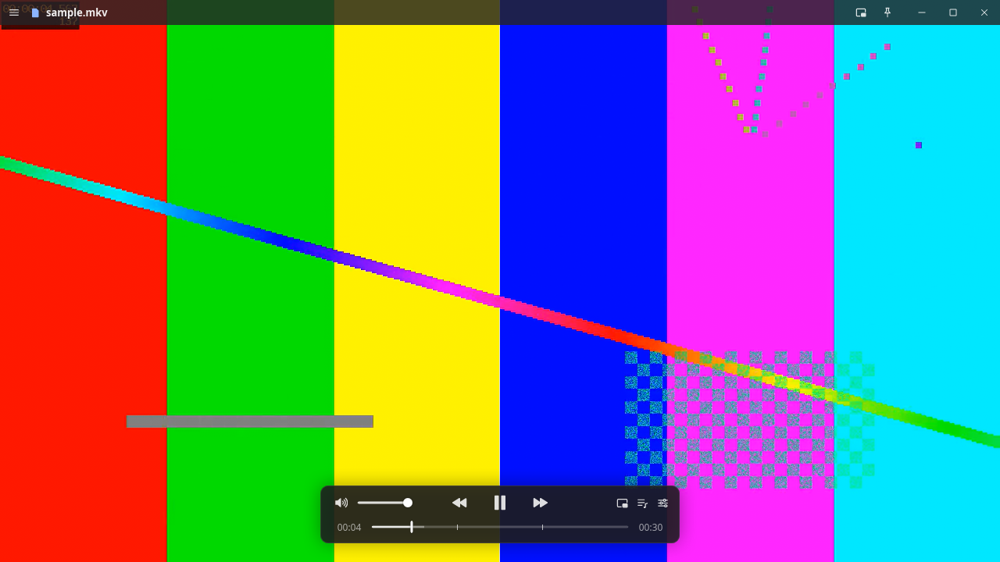
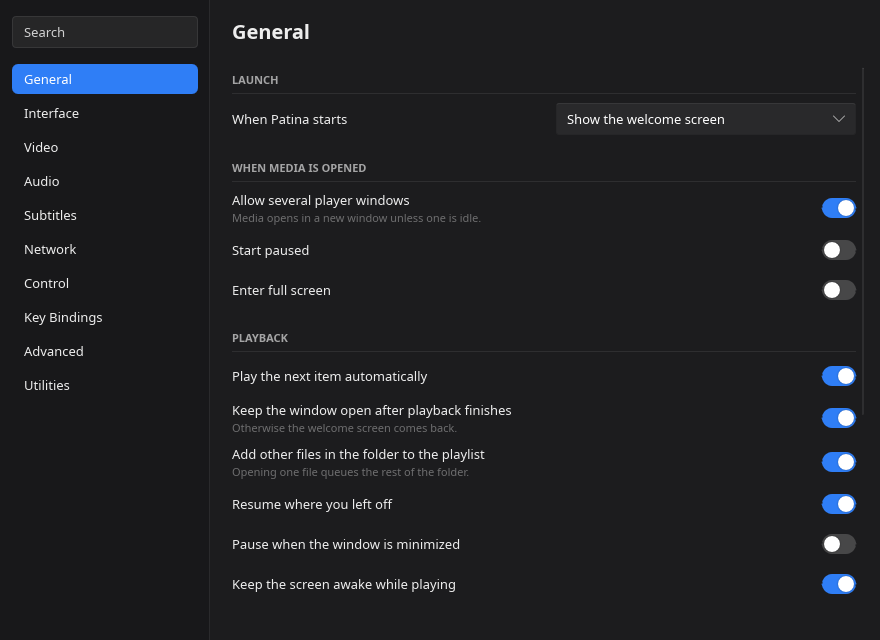

# Patina

[patina.video](https://patina.video/)

Patina is a media player for Linux, macOS and Windows, written in Rust with a
[Slint](https://slint.dev) interface on top of [mpv](https://mpv.io). It
follows [IINA](https://iina.io)'s design and behaviour, and its goal is
feature parity with IINA on all three platforms.





Patina is at an early stage. Playback, the IINA-style window and controls,
the sidebars, menus, key bindings and history work today; much of IINA is
still to come. [docs/parity.md](docs/parity.md) tracks every IINA feature
and its state in Patina.

## What works

- Video through mpv's OpenGL render API, with hardware decoding
  (VA-API tested; mpv picks the decoder)
- IINA's window: video edge to edge, a title bar and floating controller
  that fade out together, a draggable controller, and a welcome view with
  resume, open and recent files
- The controller: volume, play/pause, IINA's speed-ladder arrow buttons,
  toolbar buttons, a seek bar with buffered range, chapter ticks and A-B
  loop range, and a hover preview with a thumbnail, the time and the chapter
  (thumbnails are made in the background and cached)
- On-screen messages for volume, seeking, speed, delays, tracks, loops,
  chapters and video adjustments
- The playlist and chapters sidebar, with other files from the same folder
  added automatically, each file's length and how much of it you watched,
  title and artist for tagged music, multi-select, drag-and-drop
  reordering, copy and paste, and IINA's row menu (play next, subtitles for
  one file, move to trash, ...)
- Quick settings for video (tracks, aspect ratio, crop, rotation, flip,
  mirror, speed, deinterlacing, hardware decoding, colour), audio (tracks,
  external audio, delay, 10-band equalizer, output device) and subtitles
  (primary and secondary tracks, external files, delay, scale, position)
- Subtitle files found for you as IINA does: by name, by episode number
  across a season folder, in subfolders such as `Subs/`, preferred
  languages first
- An application menu (right click, or the title bar's menu button) with
  IINA's File, Playback, Video, Audio, Subtitles, Window and Help menus
- A preferences window with IINA's pages and a search field; changes
  apply to running players immediately
- Key bindings in mpv's `input.conf` format with IINA's defaults, edited in
  the preferences with a key recorder; IINA's `#@iina` lines work as-is
- Media keys and the desktop's player controls (MPRIS on Linux; the
  Windows and macOS equivalents are written but not yet tested)
- Mouse actions: click, double click, right and middle click, and the
  scroll wheel for volume, seeking or speed, as in IINA's control
  preferences
- Several windows at once, each with its own player
- Keeping the screen awake during playback
- A playback history window, grouped by day or folder and searchable, and
  an inspector with the file, its tracks, live playback statistics and any
  mpv property you choose to watch
- Resuming where you left off, screenshots, URLs and network streams, A-B
  loops, and a compact always-on-top picture-in-picture window

Written but not yet tested: drag and drop, playing from standard input,
online video through mpv's yt-dlp support, saving playlists, and pausing
when minimized.

## Requirements

- Rust 1.99.1, which `rust-toolchain.toml` selects automatically
- libmpv from mpv 0.39 or newer, built with Lua (developed against 0.41).
  Ubuntu 26.04 and Debian 13 ship a recent enough one; Ubuntu 24.04 (0.37)
  and Debian 12 (0.35) are too old
- OpenGL 3 or OpenGL ES 3 (mpv's minimum is OpenGL 2.1 or ES 2.0)

Patina loads libmpv when it starts rather than linking to it, so building
needs no mpv development files. It looks for the library beside the
executable first (in `lib/` on Linux, `../Frameworks` on macOS), then on the
system search path, and on macOS in Homebrew's and MacPorts' prefixes.
`PATINA_LIBMPV` can point to a specific file.

### Linux

Install mpv from your distribution (Arch: `mpv`; Debian and Ubuntu:
`libmpv2`). Building the interface also needs `pkg-config` and the
fontconfig development files (Debian and Ubuntu: `libfontconfig-dev`).
Wayland and X11 both work.

### macOS and Windows

CI builds Patina and runs its tests on both, but the player itself has not
been run there yet. On macOS, Homebrew's `mpv` provides libmpv. On Windows,
put `libmpv-2.dll` beside `patina.exe`, for example from an `mpv-dev`
archive of [zhongfly/mpv-winbuild](https://github.com/zhongfly/mpv-winbuild/releases)
or [shinchiro/mpv-winbuild-cmake](https://github.com/shinchiro/mpv-winbuild-cmake/releases).
Those builds also need `vulkan-1.dll`, which mpv's own Windows release ships
beside `mpv.exe`.

## Building and running

```sh
cargo run --release -- movie.mkv
```

```text
Usage: patina [OPTIONS] [FILE | URL | -] ...

  -e, --enqueue          Add the inputs to the playlist of the newest window
  -f, --fullscreen       Start in fullscreen
      --mpv-NAME=VALUE   Set an mpv option (e.g. --mpv-hwdec=no)
  -v, --verbose          Log mpv and Patina diagnostics to stderr
```

## Controls

The defaults follow IINA, with Ctrl in place of Command outside macOS.
Help > Keyboard Shortcuts lists all of them.

| Keys | Action |
| --- | --- |
| Space, p | Play / pause |
| ← / → | Seek 5 seconds |
| Alt+← / Alt+→ | Previous / next frame |
| ↑ / ↓ | Volume |
| Ctrl+← / Ctrl+→ | Previous / next file |
| Ctrl+[ / Ctrl+] | Half / double speed (Ctrl+\\ resets) |
| f, Enter / Esc | Toggle, enter or leave full screen (also F11) |
| Ctrl+O, Ctrl+Shift+O | Open file, open URL |
| Ctrl+Shift+P / C | Playlist / chapters |
| Ctrl+Shift+V / A / S | Video / audio / subtitle settings |
| Ctrl+S | Screenshot |
| Ctrl+L | A-B loop |
| Shift+Z / Shift+X, Shift+C | Subtitle delay, reset |
| ( / ), _ | Audio delay, reset |
| Ctrl+J | Jump to a time |
| Ctrl+, | Preferences |
| Ctrl+Y, Ctrl+I | Playback history, inspector |
| Ctrl+W, Ctrl+Q | Close the window, quit |

With the mouse: double click toggles full screen, a click shows or hides the
controls, right click opens the menu (pause on macOS), the wheel changes the
volume, and a horizontal scroll seeks. Drag the video to move the window, and
drag the controller to move it.

## Configuration

| Platform | Settings | Data (history, resume positions) |
| --- | --- | --- |
| Linux | `~/.config/patina` | `~/.local/share/patina` |
| macOS | `~/Library/Application Support/video.patina.Patina` | same |
| Windows | `%APPDATA%\Patina\config` | `%APPDATA%\Patina\data` |

- `settings.json` holds the preferences (Ctrl+, opens the window that
  edits them); any key left out takes its default.
- `input_conf/` holds your key binding sets, one `.conf` file each in mpv's
  syntax. Lines like `#@patina Ctrl+o open-file` (or IINA's `#@iina ...`)
  run Patina actions, so IINA's binding files can be copied in as they are.
- An `mpv` folder holds mpv's own `mpv.conf`, `scripts/`, `script-opts/`
  and `fonts/`.

`PATINA_CONFIG_DIR` and `PATINA_DATA_DIR` override the locations.

## Diagnostics

- `--verbose` logs Patina and mpv to stderr; `RUST_LOG=patina=trace`
  also logs every property change mpv reports.
- `PATINA_FRAME_DUMP=frame.ppm` writes the video frame mpv rendered, about
  once a second, which helps tell a rendering problem from a decoding one.

## Development

See [docs/development.md](docs/development.md) for the source layout and
working rules, and [docs/architecture.md](docs/architecture.md) for how the
pieces fit.

```sh
cargo test
cargo clippy --all-targets -- -D warnings
cargo fmt
```

## License

MIT. Patina is an independent project, not affiliated with IINA, and
contains no IINA code or artwork. mpv, FFmpeg, Slint and the other
dependencies keep their own licenses; note that mpv is GPL-licensed by
default, which applies to builds that bundle it.
